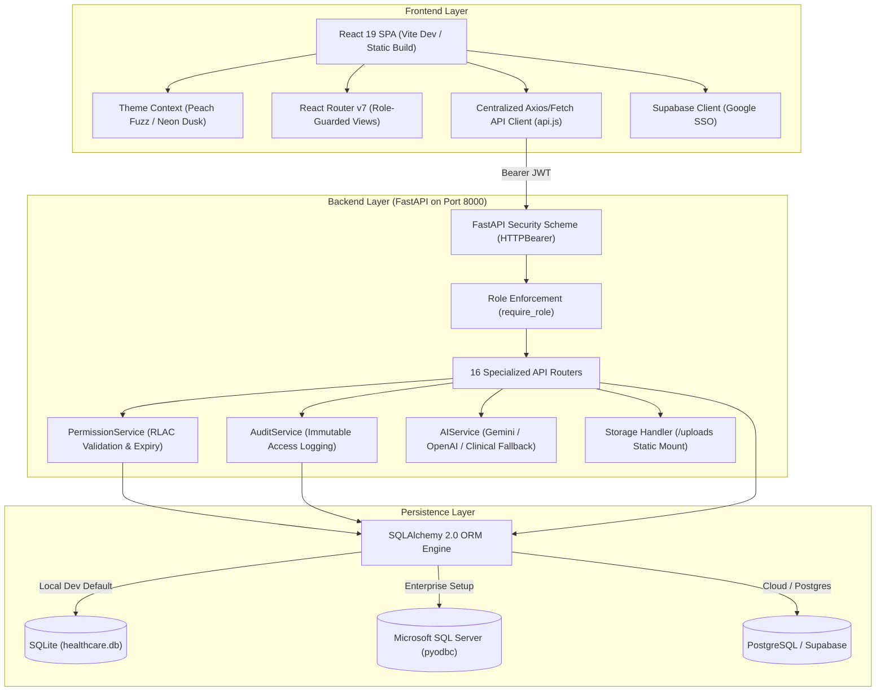
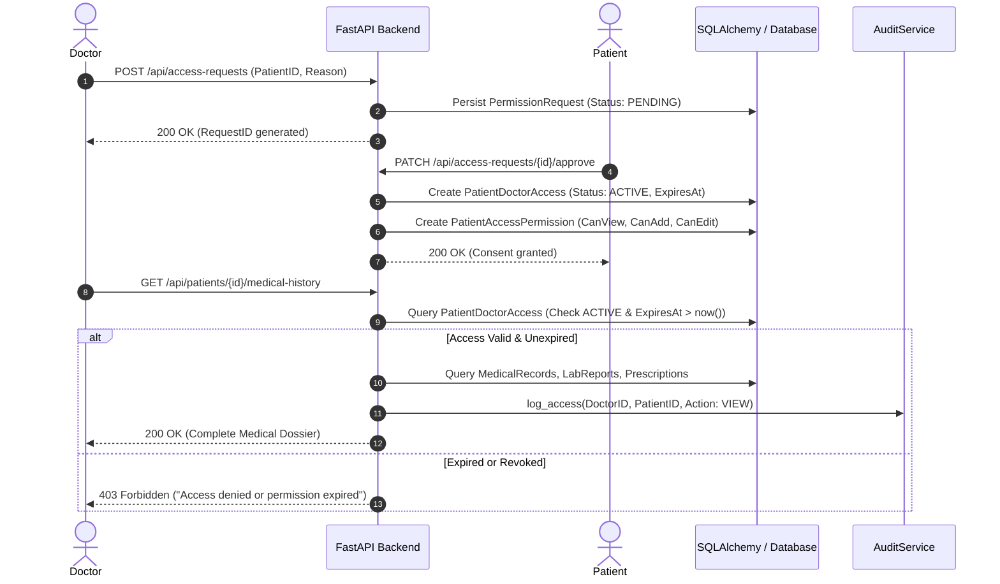

# 🏥 AI Care Coordination Platform

> **An enterprise-grade, privacy-first healthcare coordination ecosystem connecting Patients, Clinicians, Hospital Administrators, Laboratories, and Pharmacies through granular access governance, immutable audit logging, and clinician-verified AI assistance.**

[](https://python.org)
[](https://fastapi.tiangolo.com)
[](https://react.dev)
[](https://vitejs.dev)
[](https://www.sqlalchemy.org)
[](backend/tests/test_backend.py)
[](#20-license)

---

## 📋 Table of Contents

1. [Header & Overview](#-header--overview)
2. [Project Overview](#-project-overview)
3. [Features by Category](#-features-by-category)
4. [System Architecture](#-system-architecture)
5. [Technology Stack](#-technology-stack)
6. [Installation & Local Setup](#-installation--local-setup)
7. [Environment Variables](#-environment-variables)
8. [Usage Guide & Test Accounts](#-usage-guide--test-accounts)
9. [API Documentation](#-api-documentation)
10. [Project Structure](#-project-structure)
11. [Technical Highlights](#-technical-highlights)
12. [Performance Considerations](#-performance-considerations)
13. [Security Architecture](#-security-architecture)
14. [Testing Suite](#-testing-suite)
15. [Deployment Runtime](#-deployment-runtime)
16. [Screenshots & UI Showcase](#-screenshots--ui-showcase)
17. [Roadmap](#-roadmap)
18. [Contributing Guidelines](#-contributing-guidelines)
19. [License](#-license)
20. [Author & Contact](#-author--contact)
21. [Acknowledgements](#-acknowledgements)
22. [Support](#-support)
23. [Missing Information & Action Items](#-missing-information--action-items)

---

## 🎯 Project Overview

### Problem Statement
In traditional healthcare management, clinical data is severely fragmented across visiting physicians, independent diagnostic laboratories, community pharmacies, and hospital administrators. This fragmentation introduces three critical systemic failures:
1. **Clinical Blindspots**: Attending physicians often make diagnostic and prescribing decisions without visibility into concurrent treatments or recent diagnostic lab work.
2. **Patient Disenfranchisement**: Patients rarely maintain sovereignty over who accesses their medical history, lacking granular control over time-limited or resource-specific clinical access.
3. **Unvalidated AI Risk**: Direct-to-patient generative AI tools often introduce clinical hallucinations without human physician oversight, violating medical safety baselines.

### Solution & Value Proposition
The **AI Care Coordination Platform** resolves these challenges by delivering a secure, consolidated healthcare operations ecosystem centered around **Patient Sovereignty**, **Role-Tailored Workflows**, and **Clinician-in-the-Loop AI Governance**:

- **Patient-Centric Consent (RLAC)**: Patients grant explicit, time-delimited access permissions to physicians per resource type (`MEDICAL_RECORD`, `LAB_REPORT`, `PRESCRIPTION`, `APPOINTMENT`, `DIAGNOSIS`) with granular permissions (`CanView`, `CanAdd`, `CanEdit`).
- **Five Specialized Role Portals**: Custom interfaces built specifically for **Patients**, **Doctors**, **Hospital Administrators**, **Laboratory Technicians**, and **Pharmacists**.
- **Clinician-Verified AI Workflow**: All care coordination recommendations generated via LLMs (Google Gemini or OpenAI) are placed into a `PENDING` queue that requires attending physician review and validation before taking effect in clinical records.
- **HIPAA-Aligned Access Audit Trail**: Every sensitive query, record view, and report download is recorded in an immutable `AccessAuditLog` table.
- **Hybrid Database Compatibility**: Out-of-the-box zero-config execution on SQLite for local development, with native connection-pooling support for Microsoft SQL Server (via `pyodbc`) and PostgreSQL / Supabase for enterprise deployment.

### Target Personas & Primary Use Cases

| Persona | Core Operations & Primary Use Cases |
| :--- | :--- |
| **Patient** | Views consolidated health dashboard, grants or revokes physician consent, books appointments, and interacts with the care coordination AI assistant. |
| **Doctor / Clinician** | Inspects authorized patient records, issues multi-item prescriptions, creates ICD-10 diagnoses, and validates/rejects AI-generated care recommendations. |
| **Laboratory Technician** | Receives diagnostic test orders, updates order statuses (`ORDERED` ➔ `IN_PROGRESS` ➔ `COMPLETED`), and uploads PDF/image diagnostic reports. |
| **Pharmacist** | Manages prescription fulfillment lifecycles (`PENDING` ➔ `PROCESSING` ➔ `READY` ➔ `COMPLETED`) and queries the 40+ drug catalog. |
| **Hospital Administrator** | Inspects organization-wide operations, manages staff and clinics, and reviews immutable compliance access audit logs. |

---

## ✨ Features by Category

### 👤 Patient Sovereignty & Consent Management
- **Consolidated Health Dashboard**: Real-time view of active prescriptions, recent lab reports, diagnostic history, and upcoming consultations.
- **Granular Consent Engine**: Inspect incoming doctor access requests, configure granular resource rights (`CanView`, `CanAdd`, `CanEdit`), assign expiration timestamps, or immediately revoke active access.
- **Consultation Scheduling**: Book appointments with registered physicians by specialty.
- **Care Coordination AI Assistant**: Natural language patient health assistance with automated clinical safety disclaimers and offline clinical fallback.
- **Demographics & Profile Management**: Maintain contact info, blood group, and emergency contact details.

### 🩺 Doctor & Clinical Care Suite
- **Consent-Gated Patient Directory**: Access patient clinical histories strictly after explicit consent is granted and active.
- **Clinical Records & Diagnoses**: Document clinical notes and assign standardized ICD-10 diagnosis codes.
- **Prescription Ordering Engine**: Issue structured prescriptions linked to an international medicine catalog with dosage, frequency, and duration specifications.
- **Clinician AI Review Queue**: Inspect AI-drafted follow-up recommendations and approve (`REVIEWED`) or dismiss (`REJECTED`) them.
- **Appointment Lifecycle Operations**: Confirm, cancel, or mark consultations as completed.

### 🔬 Diagnostic Laboratory Portal
- **Test Order Management Pipeline**: Track laboratory test orders across four lifecycle stages: `ORDERED`, `IN_PROGRESS`, `COMPLETED`, and `CANCELLED`.
- **Diagnostic Report & Attachment Uploads**: Secure file upload handling (PDF, PNG, JPG, JPEG, DOCX) with 10MB size limits and file extension validation.
- **Results Summaries**: Enter structured diagnostic notes and link reports to attending physicians.

### 💊 Pharmacy & Dispensing Portal
- **Medication Order Fulfillment Pipeline**: Manage pharmacy orders through status stages (`PENDING` ➔ `PROCESSING` ➔ `READY` ➔ `COMPLETED`).
- **Global Medicine Catalog**: Searchable repository of 40+ international medicines categorized by therapeutic class, dosage form, strength, and manufacturer.
- **Dispensing Auditing**: Record dispensing timestamps and pharmacy fulfillment notes.

### 🛡️ Administration, Governance & Security
- **Immutable Access Audit Logging**: Automatic logging of user IDs, patient IDs, resource types, actions (`VIEW`, `ADD`, `EDIT`, `DELETE`, `DOWNLOAD`), and timestamps.
- **Role-Based Access Control (RBAC)**: Strict role barriers preventing horizontal and vertical privilege escalation across 5 distinct roles.
- **Organization Management**: Multi-clinic and hospital facility registration and oversight.

### 🎨 Design System & Theming
- **Dual Visual Theme System**:
  - **Light Mode ("Peach Fuzz + Slate Grav")**: Main background `#FEDAB8`, text/accents `#203C3D`.
  - **Dark Mode ("Neon Dusk")**: Main background `#020024`, accents `#00D4FF`, high-contrast white text `#FFFFFF`.
- **Zero-Flash Persistence**: Inline `<head>` initialization script reading from `localStorage` preventing Flash of Unstyled Content (FOUC).

---

## 🏗️ System Architecture

The platform implements a decoupled, modern client-server architecture:



### Data Flow: Resource-Level Access Control (RLAC) Lifecycle



---

## 🧪 Technology Stack

> [!NOTE]
> All technologies listed below are directly traceable to existing repository configuration files (`backend/requirements.txt`, `backend/app/config.py`, `frontend/package.json`).

| Domain | Technology | Version | Purpose in Codebase |
| :--- | :--- | :--- | :--- |
| **Frontend Framework** | [React](https://react.dev/) | `^19.2.8` | Declarative component UI architecture |
| **Frontend DOM** | [React DOM](https://react.dev/) | `^19.2.8` | React DOM rendering engine |
| **Frontend Routing** | [React Router DOM](https://reactrouter.com/) | `^7.18.4` | Client-side routing, navigation, and protected role layouts |
| **Build Tool & Dev Server**| [Vite](https://vitejs.dev/) | `^8.3.0` | Ultra-fast HMR and production bundling |
| **Icons** | [Lucide React](https://lucide.dev/) | `^1.52.0` | Modern, consistent iconography across all portals |
| **OAuth & Federated Auth**| [@supabase/supabase-js](https://supabase.com/) | `^2.117.3` | Client-side Google OAuth 2.0 authentication integration |
| **Linting** | [ESLint](https://eslint.org/) | `^10.10.0` | Frontend code quality and React hook rules enforcement |
| **Backend Framework** | [FastAPI](https://fastapi.tiangolo.com/) | `>=0.110.0` | High-performance asynchronous REST API framework |
| **ASGI Web Server** | [Uvicorn](https://www.uvicorn.org/) | `>=0.28.0` | Production ASGI web server |
| **ORM & Database Toolkit** | [SQLAlchemy](https://www.sqlalchemy.org/) | `>=2.0.28` | Object-Relational Mapping, relational schemas, connection pooling |
| **Validation & Schemas** | [Pydantic](https://docs.pydantic.dev/) | `>=2.6.4` | Request parsing, type coercion, and JSON serialization |
| **Settings Management** | [pydantic-settings](https://pypi.org/project/pydantic-settings/) | `>=2.2.1` | Type-safe environment variable parsing via `SettingsConfigDict` |
| **Email Validation** | [email-validator](https://pypi.org/project/email-validator/) | `>=2.1.0` | Strict RFC 5322 email syntax validation |
| **Token Authentication** | [PyJWT](https://pyjwt.readthedocs.io/) | `>=2.8.0` | Stateless HMAC-SHA256 JWT generation and validation |
| **Password Hashing** | [Passlib](https://passlib.readthedocs.io/) + [Bcrypt](https://pypi.org/project/bcrypt/) | `>=1.7.4` / `>=4.1.2`| PBKDF2-SHA256 and Bcrypt cryptographic password hashing |
| **Form & Multipart Parser**| [python-multipart](https://pypi.org/project/python-multipart/)| `>=0.0.9` | Multipart form parsing for diagnostic report document uploads |
| **SQL Server Driver** | [pyodbc](https://pypi.org/project/pyodbc/) | `>=5.1.0` | ODBC bridge for Microsoft SQL Server enterprise database connectivity |
| **AI LLM Providers** | [google-generativeai](https://pypi.org/project/google-generativeai/) / [openai](https://pypi.org/project/openai/) | `>=0.4.1` / `>=1.0.0` | Gemini 1.5 Flash and OpenAI GPT-3.5 clinical draft engines |
| **Cloud Client** | [supabase-py](https://pypi.org/project/supabase/) | `>=2.3.0` | Backend Supabase cloud authentication synchronization |
| **Testing Engine** | [pytest](https://docs.pytest.org/) | `>=8.1.1` | Automated test discovery and test assertion runner |
| **HTTP Test Client** | [HTTPX](https://www.python-httpx.org/) | `>=0.27.0` | Asynchronous and synchronous HTTP test client for FastAPI |
| **Local Orchestration** | Windows Batch Script | Custom | `start_app.bat` concurrent launcher for backend and frontend |

---

## 🚀 Installation & Local Setup

### System Prerequisites
Ensure your workstation meets the following minimum version requirements:
- **Python**: Version `3.12` or higher (tested up to `3.14`)
- **Node.js**: Version `18.0.0` or higher
- **npm**: Version `9.0.0` or higher
- **Git**: Installed and configured
- *(Optional)* **Microsoft SQL Server**: Required only if switching away from the default local SQLite database engine.

---

### Step 1: Clone the Repository

```bash
git clone https://github.com/saiashish13/Health-Coordination-System.git
cd Health-Coordination-System
```

---

### Step 2: Backend Setup & Environment Configuration

1. Navigate to the backend directory:
   ```bash
   cd backend
   ```
2. Create and activate a Python virtual environment:
   ```bash
   # Windows (PowerShell / Command Prompt)
   python -m venv venv
   venv\Scripts\activate

   # macOS / Linux
   python3 -m venv venv
   source venv/bin/activate
   ```
3. Install the required Python packages:
   ```bash
   pip install --upgrade pip
   pip install -r requirements.txt
   ```
4. Configure backend environment variables:
   ```bash
   # Windows
   copy .env.example .env

   # macOS / Linux
   cp .env.example .env
   ```

---

### Step 3: Database Initialization & Seeding

Populate the database with fictional clinical organizations, pre-configured role accounts, appointment records, and medicine catalog entries:

```bash
# Seed initial users, appointments, records, and permissions
python seed.py

# Populate the 40+ international medicines catalog
python update_seed_medicines.py
```

> [!TIP]
> By default, the application runs on SQLite (`healthcare.db`). If `DB_SERVER` or `DATABASE_URL` is configured in `.env`, the seeder connects to and provisions tables on Microsoft SQL Server or PostgreSQL/Supabase automatically.

---

### Step 4: Frontend Setup & Environment Configuration

1. Open a new terminal window and navigate to the frontend directory:
   ```bash
   cd frontend
   ```
2. Install Node dependencies:
   ```bash
   npm install
   ```
3. Configure frontend environment variables:
   ```bash
   # Windows
   copy .env.example .env

   # macOS / Linux
   cp .env.example .env
   ```

---

### Step 5: Running Locally

#### Method A: Automated One-Click Launcher (Windows)
From the repository root, run the bundled batch launcher:
```cmd
.\start_app.bat
```
*This script cleans up stale processes on ports 8000 and 5173, starts Uvicorn ASGI on port 8000, and launches Vite development server on port 5173.*

#### Method B: Manual Execution

**Terminal 1 — Backend API:**
```bash
cd backend
python -m uvicorn app.main:app --reload --host 127.0.0.1 --port 8000
```
- API Base: `http://127.0.0.1:8000`
- Swagger OpenAPI Docs: `http://127.0.0.1:8000/docs`
- ReDoc Docs: `http://127.0.0.1:8000/redoc`

**Terminal 2 — Frontend Application:**
```bash
cd frontend
npm run dev
```
- Web Application: `http://127.0.0.1:5173`

---

## 🔐 Environment Variables

### Backend Configuration (`backend/.env`)

| Variable Name | Required | Default Value | Description |
| :--- | :---: | :--- | :--- |
| `PROJECT_NAME` | No | `AI Care Coordination Platform Backend` | Project title displayed in Swagger and OpenAPI metadata. |
| `VERSION` | No | `1.0.0` | API application version string. |
| `DATABASE_URL` | No | `sqlite:///./healthcare.db` | Overrides database connection string. Supports PostgreSQL (`postgresql+psycopg2://`) or custom SQLite path. |
| `DB_SERVER` | No | `""` *(empty)* | Hostname or IP of Microsoft SQL Server instance. If empty, falls back to SQLite. |
| `DB_PORT` | No | `1433` | Microsoft SQL Server port. |
| `DB_NAME` | No | `HealthcareDB` | Microsoft SQL Server database name. |
| `DB_USER` | No | `sa` | SQL Server authentication username. |
| `DB_PASSWORD` | No | `""` | SQL Server authentication password. |
| `DB_DRIVER` | No | `ODBC Driver 18 for SQL Server` | Name of installed ODBC driver for SQL Server. |
| `JWT_SECRET` | **Yes** | `super-secret-key-change-in-production-ai-care-platform-2026` | Cryptographic secret key used to sign and verify HS256 JWT access tokens. |
| `JWT_ALGORITHM` | **Yes** | `HS256` | JWT signature algorithm. |
| `ACCESS_TOKEN_EXPIRE_MINUTES` | **Yes** | `120` | Lifetime of user access tokens before requiring re-authentication. |
| `FRONTEND_URL` | No | `http://127.0.0.1:5173` | Allowed CORS origin for browser requests. |
| `AI_PROVIDER` | No | `mock` | Active AI provider (`mock`, `gemini`, or `openai`). Defaults to offline heuristic fallback. |
| `AI_API_KEY` | No | `""` *(empty)* | Secret API key for OpenAI (`sk-...`) or Google Gemini (`AIza...`). |
| `SUPABASE_URL` | No | `https://iqslkpwesyqjvskmovln.supabase.co` | Supabase project endpoint for cloud auth and schema sync. |
| `SUPABASE_PUBLISHABLE_KEY` | No | `sb_publishable_...` | Supabase public / anonymous client key. |
| `SUPABASE_SECRET_KEY` | No | `your_supabase_secret_key_here` | Supabase service role secret key. |
| `SUPABASE_JWKS_URL` | No | `https://.../auth/v1/.well-known/jwks.json` | JWKS endpoint for validating Supabase JWT signatures. |

### Frontend Configuration (`frontend/.env`)

| Variable Name | Required | Default Value | Description |
| :--- | :---: | :--- | :--- |
| `VITE_API_URL` | **Yes** | `http://127.0.0.1:8000/api` | Base URL pointing to the running FastAPI backend router prefix. |
| `VITE_SUPABASE_URL` | No | `https://iqslkpwesyqjvskmovln.supabase.co` | Supabase project URL for browser-based Google OAuth SSO flow. |
| `VITE_SUPABASE_ANON_KEY` | No | `your_supabase_anon_key_here` | Public anonymous key for Supabase browser client. |
| `VITE_SUPABASE_PUBLISHABLE_KEY` | No | *(alias for anon key)* | Optional alias for the Supabase anonymous publishable key. |

---

## 💻 Usage Guide & Test Accounts

### Pre-Configured Test Accounts
The database seeder (`seed.py`) initializes five role-specific accounts with pre-loaded fictional relationships and clinical records:

| Role | Email Address | Password | Primary Accessible Portals & Actions |
| :--- | :--- | :--- | :--- |
| **PATIENT** | `patient@healthcare.com` | `password123` | Patient Dashboard, Appointment Booking, Consent Manager, AI Chat |
| **DOCTOR** | `doctor@healthcare.com` | `password123` | Doctor Dashboard, Patient Dossiers, Prescription Ordering, AI Draft Review |
| **ADMIN** | `admin@healthcare.com` | `password123` | Hospital Admin Dashboard, Audit Logs, User Accounts, Organization Settings |
| **LAB** | `lab@healthcare.com` | `password123` | Laboratory Dashboard, Lab Tests Queue, Diagnostic Report Upload |
| **PHARMACY** | `pharmacy@healthcare.com` | `password123` | Pharmacy Dashboard, Medication Dispensing Orders, Medicine Catalog |

---

### End-to-End Clinical Workflow Walkthrough

1. **Patient Registration & Onboarding**:
   - Navigate to `http://localhost:5173/register` and select the **Patient** role.
   - Enter profile demographics and blood group.
2. **Consultation Scheduling**:
   - Log in as the patient and visit `/appointments` to book a consultation with `Dr. Test Doctor`.
3. **Physician Access Request**:
   - Log in as `doctor@healthcare.com`. Attempting to access an unassigned patient triggers an access request prompt (`POST /api/access-requests`).
4. **Consent Approval**:
   - Switch back to `patient@healthcare.com`. In the Consent Manager (`/permission-requests`), approve the pending doctor request, granting `CanView` and `CanAdd` permissions with an expiration timestamp.
5. **Clinical Documentation & AI Draft**:
   - Log in as the doctor. Access the patient's record at `/patients/{id}`. Add clinical notes.
   - The backend AI service automatically parses symptoms and places an AI Care Recommendation draft in `PENDING` state.
6. **Physician AI Verification**:
   - In `/doctor-review`, the doctor reviews the draft care plan and signs off (`REVIEWED`), promoting it into the patient's authoritative record.
7. **Diagnostic & Pharmacy Fulfillment**:
   - The doctor orders a laboratory blood test and issues a prescription.
   - `lab@healthcare.com` uploads diagnostic PDF results.
   - `pharmacy@healthcare.com` transitions the prescription order from `PROCESSING` to `READY` to `COMPLETED`.

---

## 📖 API Documentation

The FastAPI backend exposes an OpenAPI 3.0 specification available at:
- **Interactive Swagger UI**: `http://localhost:8000/docs`
- **ReDoc UI**: `http://localhost:8000/redoc`

### Standard Response Envelope
All API endpoints adhere to a standardized JSON response shape:

```json
{
  "success": true,
  "message": "Operation completed successfully",
  "data": {}
}
```

### Core API Endpoints

```
========================================================================================
CATEGORY           METHOD   ENDPOINT                                  AUTH / ROLE
========================================================================================
Authentication     POST     /api/auth/register                        Public
                   POST     /api/auth/login                           Public
                   POST     /api/auth/google                          Public
                   GET      /api/auth/me                              Bearer Token
----------------------------------------------------------------------------------------
Patients           GET      /api/patients                             Doctor, Admin
                   GET      /api/patients/{id}                        Authenticated (Self/Dr)
                   PUT      /api/patients/{id}                        Patient (Self)
                   GET      /api/patients/{id}/medical-history        Doctor (RLAC Checked)
                   GET      /api/patients/{id}/timeline               Doctor (RLAC Checked)
----------------------------------------------------------------------------------------
Doctors            GET      /api/doctors                              Authenticated
                   GET      /api/doctors/{id}                         Authenticated
                   PUT      /api/doctors/me                           Doctor
                   GET      /api/doctors/{id}/patients                Doctor (Self)
----------------------------------------------------------------------------------------
Appointments       GET      /api/appointments                         Authenticated
                   POST     /api/appointments                         Patient, Doctor
                   GET      /api/appointments/{id}                    Authenticated
                   PATCH    /api/appointments/{id}/status             Doctor, Patient
----------------------------------------------------------------------------------------
Medical Records    GET      /api/medical-records                      Doctor, Patient
                   POST     /api/medical-records                      Doctor (CanAdd)
                   GET      /api/medical-records/{id}                 Doctor, Patient
----------------------------------------------------------------------------------------
Diagnoses          GET      /api/diagnoses                            Doctor, Patient
                   POST     /api/diagnoses                            Doctor (CanAdd)
----------------------------------------------------------------------------------------
Laboratory         GET      /api/lab-tests                            Doctor, Lab, Patient
                   POST     /api/lab-tests                            Doctor
                   PATCH    /api/lab-tests/{id}/status                Lab Technician
                   GET      /api/lab-reports                          Doctor, Lab, Patient
                   POST     /api/lab-reports                          Lab Technician
                   POST     /api/lab-reports/{id}/file                Lab Technician (Multipart)
----------------------------------------------------------------------------------------
Pharmacy & Meds    GET      /api/medicines                            Authenticated
                   POST     /api/medicines                            Admin, Pharmacy
                   GET      /api/prescriptions                        Doctor, Patient, Pharmacy
                   POST     /api/prescriptions                        Doctor
                   GET      /api/medication-orders                    Pharmacy, Patient, Doctor
                   PATCH    /api/medication-orders/{id}/status        Pharmacy
----------------------------------------------------------------------------------------
Consent & RLAC     POST     /api/access-requests                      Doctor
                   GET      /api/access-requests                      Doctor, Patient
                   PATCH    /api/access-requests/{id}/approve         Patient
                   PATCH    /api/access-requests/{id}/reject          Patient
                   PATCH    /api/access-requests/{id}/revoke          Patient
                   GET      /api/patient-doctor-access                Doctor, Patient
                   GET      /api/patient-access-permissions/{id}      Doctor, Patient
                   PUT      /api/patient-access-permissions/{id}      Patient
----------------------------------------------------------------------------------------
AI Coordination    POST     /api/ai/interactions                     Patient, Doctor
                   GET      /api/ai/interactions                     Patient (Self), Doctor
                   POST     /api/ai/recommendations                   Doctor, System
                   GET      /api/ai/recommendations                   Doctor, Patient
                   PATCH    /api/ai/recommendations/{id}/review       Doctor
----------------------------------------------------------------------------------------
Admin & Governance GET      /api/admin/audit-logs                     Admin
                   GET      /api/admin/users                          Admin
                   PATCH    /api/admin/users/{id}/status              Admin
                   GET      /api/admin/stats                          Admin
----------------------------------------------------------------------------------------
Dashboards         GET      /api/dashboards/patient                   Patient
                   GET      /api/dashboards/doctor                    Doctor
                   GET      /api/dashboards/admin                     Admin
                   GET      /api/dashboards/lab                       Lab Technician
                   GET      /api/dashboards/pharmacy                  Pharmacy
========================================================================================
```

---

## 📂 Project Structure

```
Health-Coordination-System/
├── backend/
│   ├── app/
│   │   ├── dependencies/             # Injected security & role verification
│   │   │   └── auth_deps.py          # HTTPBearer token decoding & require_role decorators
│   │   ├── models/                   # 20 SQLAlchemy declarative ORM data models
│   │   │   ├── ai_interaction.py     # Patient Q&A queries and assistant replies
│   │   │   ├── ai_recommendation.py  # AI clinical recommendations pending physician review
│   │   │   ├── appointment.py        # Consultation scheduling & status lifecycle
│   │   │   ├── audit_log.py          # Immutable HIPAA-aligned access audit log
│   │   │   ├── diagnosis.py          # ICD-10 diagnosis entries linked to medical records
│   │   │   ├── doctor.py             # Doctor profile, specialty, license number
│   │   │   ├── lab_report.py         # Lab report summaries and attachment file references
│   │   │   ├── lab_test.py           # Ordered diagnostic lab tests
│   │   │   ├── medical_record.py     # Clinical notes and consultation documents
│   │   │   ├── medication_order.py   # Pharmacy fulfillment pipeline
│   │   │   ├── medicine.py           # Standardized drug catalog
│   │   │   ├── notification.py       # In-app notifications
│   │   │   ├── organization.py       # Hospitals, clinics, and laboratory facilities
│   │   │   ├── patient.py            # Patient demographics and medical profiles
│   │   │   ├── patient_access_permission.py # Granular permissions (CanView, CanAdd, CanEdit)
│   │   │   ├── patient_doctor_access.py     # Active consent links and expiration timestamps
│   │   │   ├── permission_request.py # Consent request workflow entries
│   │   │   ├── prescription.py       # Issued doctor prescriptions
│   │   │   ├── prescription_item.py  # Prescription line items (dosage, frequency, duration)
│   │   │   └── user.py               # Core user credentials and role definitions
│   │   ├── routers/                  # 16 FastAPI endpoint router modules
│   │   │   ├── admin.py              # Audit logs, user administration, metrics
│   │   │   ├── ai.py                 # Health assistant queries & physician review queue
│   │   │   ├── appointments.py       # Appointment booking, rescheduling, cancellations
│   │   │   ├── auth.py               # Registration, login, Google SSO synchronization
│   │   │   ├── dashboards.py         # Aggregated portal metrics for all 5 roles
│   │   │   ├── diagnoses.py          # Diagnostic logging & ICD-10 code assignment
│   │   │   ├── doctors.py            # Physician profile management & patient lists
│   │   │   ├── lab.py                # Diagnostic test orders & report uploads
│   │   │   ├── medical_records.py    # Clinical notes & history retrieval
│   │   │   ├── medication_orders.py  # Pharmacy dispensing operations
│   │   │   ├── medicines.py          # Drug catalog querying and creation
│   │   │   ├── notifications.py      # User notifications retrieval and read receipts
│   │   │   ├── organizations.py      # Hospital and clinic directory
│   │   │   ├── patients.py           # Patient profile CRUD & timeline generation
│   │   │   ├── permissions.py        # Consent request, approval, and revocation logic
│   │   │   └── prescriptions.py      # Multi-item prescription ordering
│   │   ├── schemas/                  # Pydantic request/response validation models
│   │   ├── security/                 # Cryptographic primitives
│   │   │   ├── jwt.py                # PyJWT HS256 token creation and validation
│   │   │   └── passwords.py          # Passlib CryptContext (PBKDF2-SHA256 & Bcrypt)
│   │   ├── services/                 # Core domain business logic
│   │   │   ├── ai_service.py         # Multi-provider LLM abstraction (OpenAI / Gemini / Fallback)
│   │   │   ├── audit_service.py      # Centralized immutable access logging service
│   │   │   ├── notification_service.py # In-app alert dispatching
│   │   │   └── permission_service.py # RLAC validation & time-expiration checker
│   │   ├── utils/
│   │   │   └── storage.py            # Upload validator (whitelist check, 10MB limit, UUID filenames)
│   │   ├── config.py                 # Pydantic BaseSettings environment loader
│   │   ├── database.py               # SQLAlchemy engine, SessionLocal, Base
│   │   └── main.py                   # FastAPI application initialization, CORS, router mounting
│   ├── tests/
│   │   └── test_backend.py           # Automated integration test suite running on in-memory SQLite
│   ├── uploads/                      # Local filesystem storage for diagnostic attachments
│   ├── .env.example                  # Backend environment variable template
│   ├── pytest.ini                    # Pytest configuration scoping test discovery
│   ├── requirements.txt              # Backend Python dependencies
│   ├── seed.py                       # Database seeder initializing test accounts across all roles
│   ├── supabase_schema.sql           # Production PostgreSQL schema definition for Supabase
│   └── update_seed_medicines.py      # Seeder for 40+ international medicines catalog
│
├── frontend/
│   ├── public/                       # Static public assets (favicon.svg, icons.svg)
│   ├── src/
│   │   ├── assets/                   # UI branding assets (hero.png)
│   │   ├── components/               # Reusable UI elements (Navbar, Footer, Badge, Modal, etc.)
│   │   ├── context/                  # React Contexts (ThemeContext, ToastContext)
│   │   ├── data/                     # World medicine catalog dataset (worldMedicines.js)
│   │   ├── pages/                    # 30 specialized view pages covering all 5 role portals
│   │   │   ├── AIInteractions.jsx    # Patient AI conversation interface
│   │   │   ├── AIRecommendations.jsx # Patient AI recommendation view
│   │   │   ├── AccessAuditLog.jsx    # Admin audit trail viewer
│   │   │   ├── Appointments.jsx      # Consultation scheduling and status updates
│   │   │   ├── Diagnoses.jsx         # Diagnostic history view
│   │   │   ├── DoctorDashboard.jsx   # Clinical summary view for physicians
│   │   │   ├── DoctorReview.jsx      # Clinician review queue for pending AI recommendations
│   │   │   ├── Doctors.jsx           # Physician directory
│   │   │   ├── HospitalDashboard.jsx # Admin management portal
│   │   │   ├── LabReports.jsx        # Diagnostic reports and PDF download interface
│   │   │   ├── LabTests.jsx          # Test order management
│   │   │   ├── LaboratoryDashboard.jsx # Lab technician queue overview
│   │   │   ├── Login.jsx             # Dual email/password & Google SSO login
│   │   │   ├── MedicalRecords.jsx    # Clinical notes and medical records
│   │   │   ├── MedicationOrders.jsx  # Pharmacy dispensing queue
│   │   │   ├── Medicines.jsx         # Searchable medicine catalog
│   │   │   ├── NotFound.jsx          # 404 error page
│   │   │   ├── Notifications.jsx     # Alert center
│   │   │   ├── Organizations.jsx     # Clinic and hospital directory
│   │   │   ├── PatientAccessPermissions.jsx # Granular permission matrix editor
│   │   │   ├── PatientDashboard.jsx  # Patient health summary
│   │   │   ├── PatientDoctorAccess.jsx # Active physician consent links viewer
│   │   │   ├── Patients.jsx          # Doctor's patient list and dossier view
│   │   │   ├── PermissionRequests.jsx # Consent requests approval/rejection manager
│   │   │   ├── PharmacyDashboard.jsx # Dispensing metrics and order queue
│   │   │   ├── PrescriptionItems.jsx # Prescription line items editor
│   │   │   ├── Prescriptions.jsx     # Prescriptions directory
│   │   │   ├── Profile.jsx           # User demographics and settings
│   │   │   ├── Register.jsx          # Role-based onboarding form
│   │   │   └── Users.jsx             # Admin user management
│   │   ├── services/                 # Client networking
│   │   │   ├── api.js                # Centralized Fetch/Axios API client with auth interceptor
│   │   │   └── supabase.js           # Supabase client initialization for Google OAuth
│   │   ├── styles/                   # Modular CSS stylesheets
│   │   ├── utils/                    # Helper functions (roleFilter.js)
│   │   ├── App.jsx                   # React Router v7 routes and layout wrappers
│   │   ├── index.css                 # CSS custom property design tokens (themes, typography)
│   │   └── main.jsx                  # React application DOM root
│   ├── .env.example                  # Frontend environment variable template
│   ├── eslint.config.js              # ESLint configuration
│   ├── index.html                    # Root HTML document with inline anti-FOUC script
│   ├── package.json                  # Node dependencies and project scripts
│   └── vite.config.js                # Vite build and plugin configuration
│
├── .gitignore                        # Git ignore patterns for venv, node_modules, and uploads
├── README.md                         # Repository technical documentation
└── start_app.bat                     # Windows batch launcher for concurrent local execution
```

---

## ⚡ Technical Highlights

### 1. Granular Resource-Level Access Control (RLAC)
Unlike basic Role-Based Access Control that only inspects `User.Role`, the platform implements a dual-layer permission verification engine via `PermissionService.verify_doctor_permission()`:
- Verifies that an explicit `PatientDoctorAccess` record exists between the doctor and patient.
- Checks whether `ExpiresAt` is in the past; if expired, dynamically flips the link status to `EXPIRED` and halts execution.
- Evaluates specific boolean flags (`CanView`, `CanAdd`, `CanEdit`) against the target resource type (`MEDICAL_RECORD`, `LAB_REPORT`, `PRESCRIPTION`, `APPOINTMENT`, `DIAGNOSIS`).

### 2. Immutable Compliance Access Auditing
To meet strict healthcare data governance standards, sensitive operations invoke `AuditService.log_access()`. This writes immutable rows into `AccessAuditLog` recording the actor (`UserID`), target subject (`PatientID`), resource category, resource primary key, action (`VIEW`, `ADD`, `EDIT`, `DELETE`, `DOWNLOAD`), and UTC timestamp. The audit log contains no destructive endpoints (`UPDATE` or `DELETE` routes do not exist).

### 3. Clinician-in-the-Loop AI Architecture
Generative AI outputs are strictly prohibited from writing directly to patient medical records without physician oversight:
- Clinical draft recommendations generated by LLMs are given status `PENDING`.
- Attending physicians inspect drafts in `/doctor-review`.
- Physicians must explicitly trigger `PATCH /api/ai/recommendations/{id}/review` to accept or reject the draft.
- If no external API keys are configured, the service seamlessly degrades to safe, deterministic clinical heuristic recommendations.

### 4. Tri-Database Engine Portability
Through SQLAlchemy 2.0 abstractions in `app/config.py` and `app/database.py`, the backend dynamically configures its database engine:
- If `DATABASE_URL` is set, it parses standard PostgreSQL connection strings (e.g., Supabase).
- If `DB_SERVER` is populated, it automatically builds a connection string for Microsoft SQL Server using `pyodbc` and `ODBC Driver 18`.
- If neither is provided, it automatically falls back to an embedded SQLite file (`healthcare.db`), allowing zero-dependency local onboarding.

### 5. Instant Theme System (Zero-FOUC)
Theme selection (`light` vs `dark`) is executed via CSS variables in `frontend/src/index.css`. An inline script inside `frontend/index.html` inspects `localStorage` and applies `data-theme` to `<html>` prior to the React DOM mount, preventing visual flashes of unstyled content.

---

## 🏎️ Performance Considerations

The codebase implements verified architectural optimizations:
- **Connection Pooling & Pre-Ping**: SQLAlchemy engine is configured with `pool_pre_ping=True` in `backend/app/database.py` to prevent stale database connections without crashing long-running workers.
- **Asynchronous Non-Blocking Handlers**: FastAPI endpoints leverage Python async/await patterns where I/O operations occur.
- **Vite Tree-Shaking & Code Splitting**: Frontend builds via Vite optimize vendor chunks (React 19, Lucide React, Supabase) for fast initial paint.
- **Static File Streaming**: Uploaded lab report PDFs and images are served directly through Starlette's `StaticFiles` mount at `/uploads`.

> [!NOTE]
> No synthetic benchmarks or invented transactions-per-second claims are asserted here. Production load testing is documented under [Missing Information](#-missing-information--action-items).

---

## 🔒 Security Architecture

### Authentication & Tokens
- **Stateless Bearer JWT**: PyJWT signs tokens with HMAC-SHA256 (`HS256`) containing `user_id`, `email`, and `role`. Tokens expire after a configurable duration (`ACCESS_TOKEN_EXPIRE_MINUTES`, default: 120 minutes).
- **Password Hashing**: Passlib `CryptContext` implements PBKDF2-SHA256 and Bcrypt (`pbkdf2_sha256`, `bcrypt`), avoiding the 72-byte truncation limitation of legacy Bcrypt implementations.
- **Federated OAuth 2.0**: Integrated with Supabase Auth for Google Single Sign-On (SSO). The backend synchronizes authenticated identities via `POST /api/auth/google`.

### Authorization & Scope Enforcement
- **Dependency-Injected Role Guards**: `require_role(["DOCTOR"])`, `require_patient`, and `require_authenticated_user` dependencies are applied to route controllers, returning `403 Forbidden` for unauthorized actors.

### Request Validation & File Storage Safety
- **Pydantic Validation**: Strict typing, length constraints, and regex email validation on all input bodies.
- **File Upload Security (`app/utils/storage.py`)**:
  - Whitelist validation of extensions: `.pdf`, `.png`, `.jpg`, `.jpeg`, `.txt`, `.csv`, `.docx`.
  - Enforced file size limit of 10 MB (`MAX_FILE_SIZE = 10 * 1024 * 1024`).
  - Filenames are replaced with cryptographic UUIDv4 identifiers (`uuid.uuid4().hex`) to prevent path traversal attacks.

> [!WARNING]
> Rate limiting (e.g., via SlowAPI / Redis) and automated CSRF tokens are not currently implemented in the backend code. They must be added prior to internet-facing production deployment.

---

## 🧪 Testing Suite

### Backend Automated Tests
The backend includes automated integration tests written in `pytest` utilizing FastAPI's `TestClient` and an isolated, shared in-memory SQLite database (`sqlite://` with `StaticPool`):

```
backend/tests/test_backend.py
├── test_root_endpoint                        # Validates API online status and version metadata
├── test_authentication_flow                  # Registration, JWT token issuance, login, /me validation
├── test_patient_and_appointment_workflow     # Patient update, appointment booking, status transition
├── test_permission_request_workflow          # Access request submission, patient approval, link creation
└── test_ai_interactions_and_doctor_review   # AI assistant query, recommendation draft, doctor sign-off
```

### Running Backend Tests

```bash
cd backend
python -m pytest -v
```

Expected output:
```text
============================= test session starts =============================
platform win32 -- Python 3.14.x, pytest-8.1.1
collected 5 items

tests/test_backend.py::test_root_endpoint PASSED                         [ 20%]
tests/test_backend.py::test_authentication_flow PASSED                   [ 40%]
tests/test_backend.py::test_patient_and_appointment_workflow PASSED      [ 60%]
tests/test_backend.py::test_permission_request_workflow PASSED           [ 80%]
tests/test_backend.py::test_ai_interactions_and_doctor_review PASSED     [100%]

============================== 5 passed in 0.82s ==============================
```

### Frontend Code Verification
The frontend relies on ESLint and Vite production build compilation:

```bash
cd frontend

# Verify static type and syntax correctness
npm run lint

# Verify production bundle compilation
npm run build
```

---

## 🚢 Deployment Runtime

### Local & On-Premises Runtime
The application is structured to run directly on Windows, macOS, or Linux hosts:
- **Backend**: Managed via Uvicorn ASGI (`uvicorn app.main:app --host 0.0.0.0 --port 8000`).
- **Frontend**: Served during development via Vite dev server (`npm run dev`) or built for production via `npm run build` and previewed via `npm run preview`.
- **Database**: Runs on local SQLite or connects via TCP/IP to an existing Microsoft SQL Server or PostgreSQL instance.

> [!IMPORTANT]
> The codebase does **not** currently contain containerization files (`Dockerfile`, `docker-compose.yml`) or cloud infrastructure-as-code definitions. Refer to [Missing Information](#-missing-information--action-items) for containerization requirements.

---

## 🖼️ Screenshots & UI Showcase

| View | Screenshot / Asset | Description |
| :--- | :---: | :--- |
| **System Branding & Overview** |  | High-level care coordination architecture and portal entry point. |
| **Patient Health Dashboard** | `[ Placeholder: Patient Dashboard ]` | Displays vital stats, upcoming appointments, active prescriptions, and recent lab results. |
| **Consent & Permission Matrix** | `[ Placeholder: Consent Manager ]` | Patient interface for granting, toggling `CanView`/`CanAdd`/`CanEdit` rights, and revoking doctor access. |
| **Doctor AI Review Queue** | `[ Placeholder: Doctor Review Queue ]` | Clinician queue displaying AI-generated care recommendations awaiting approval or rejection. |
| **Diagnostic Lab Reports** | `[ Placeholder: Lab Reports Viewer ]` | Laboratory interface for uploading and downloading PDF diagnostic attachments. |

---

## 🗺️ Roadmap

### Implemented Features
- [x] 20-table relational database schema with SQLAlchemy 2.0 ORM.
- [x] Five dedicated role-tailored portals (Patient, Doctor, Admin, Lab, Pharmacy).
- [x] Granular Resource-Level Access Control (RLAC) with expiration timestamps.
- [x] Immutable access audit log for HIPAA-aligned governance.
- [x] Clinician-in-the-loop AI recommendation draft review queue.
- [x] Multi-provider AI service (OpenAI, Gemini, and offline clinical heuristic fallback).
- [x] Google OAuth 2.0 single sign-on integration via Supabase.
- [x] Standardized 40+ international medicine catalog.
- [x] Dual-theme system ("Peach Fuzz + Slate Grav" and "Neon Dusk") with zero-flash persistence.

### Proposed Future Improvements
- [ ] **Real-time WebSockets / SSE**: Push notifications for instantaneous doctor access requests and status transitions.
- [ ] **Rate Limiting Middleware**: Implement Redis-backed token-bucket rate limiting via SlowAPI.
- [ ] **Automated SMS & Email Reminders**: Integration with Twilio or SendGrid for consultation reminders.
- [ ] **HL7 FHIR Interoperability**: Export patient health records according to standard FHIR R4 JSON schemas.
- [ ] **DICOM Viewer Integration**: Native browser rendering for radiological scans and imaging series.
- [ ] **Automated Frontend Test Suite**: End-to-end integration testing using Playwright or Cypress.
- [ ] **Official Docker & Cloud CI/CD**: Containerized Dockerfile and GitHub Actions workflow definitions.

---

## 🤝 Contributing Guidelines

Contributions are welcome to expand clinical workflows and strengthen system security. Please follow these conventions:

### Branching & Workflow
1. **Fork the Repository** on GitHub.
2. **Create a Feature Branch**:
   ```bash
   git checkout -b feat/your-feature-name
   ```
3. **Commit Messages**: Follow [Conventional Commits](https://www.conventionalcommits.org/):
   - `feat: add FHIR export endpoint`
   - `fix: resolve permission expiration edge case`
   - `test: add prescription lifecycle unit test`
   - `docs: update API documentation`

### Quality Checklist Before Submitting a PR
- [ ] Backend tests pass cleanly (`cd backend && python -m pytest`).
- [ ] Frontend builds without errors (`cd frontend && npm run build`).
- [ ] Frontend passes ESLint checks (`cd frontend && npm run lint`).
- [ ] All new database models are imported into `backend/app/models/__init__.py`.
- [ ] Sensitive endpoints invoke `AuditService.log_access()`.

---

## 📜 License

> [!WARNING]
> **No formal LICENSE file exists in this repository.**
> Although previous drafts referenced the MIT License, no `LICENSE` file is currently committed to the root or subdirectories. Until a formal open-source license (such as MIT or Apache 2.0) or commercial license is added, all rights are reserved by the author.

---

## 👨‍💻 Author & Contact

- **Author**: N. Sai Ashish
- **GitHub**: [@saiashish13](https://github.com/saiashish13)
- **LinkedIn**: [N. Sai Ashish](https://www.linkedin.com/in/saiashish) *(Update with your direct profile URL)*
- **Portfolio**: `[ Insert Portfolio URL ]`
- **Email**: `[ Insert Contact Email ]`
- **Repository**: [Health-Coordination-System](https://github.com/saiashish13/Health-Coordination-System)

---

## 🙏 Acknowledgements

- [FastAPI](https://fastapi.tiangolo.com/) for the asynchronous Python REST API framework.
- [React](https://react.dev/) & [Vite](https://vitejs.dev/) for modern frontend component architecture and developer tooling.
- [SQLAlchemy](https://www.sqlalchemy.org/) for Python object-relational mapping and database engine portability.
- [Lucide Icons](https://lucide.dev/) for clean, accessible healthcare iconography.
- [Supabase](https://supabase.com/) for OAuth identity integration and hosted PostgreSQL capabilities.

---

## 💬 Support & Issue Reporting

If you encounter bugs, inconsistencies, or security concerns:
1. **Bug Reports**: Open an issue on GitHub detailing reproduction steps, expected vs. actual behavior, and environment configuration.
2. **Feature Requests**: Submit a GitHub issue titled `[Feature Request]: <description>` explaining the clinical use case and technical rationale.
3. **Security Inquiries**: For sensitive vulnerability disclosures, please contact the repository author directly.

---

## ❓ Missing Information & Action Items

To elevate this repository to complete enterprise production readiness, the following items are missing from the codebase and should be provided or configured:

1. **Formal `LICENSE` File**:
   - *Status*: Missing.
   - *Action*: Commit a `LICENSE` file (e.g., MIT, Apache 2.0, or Proprietary) in the repository root.
2. **Containerization & Deployment Manifests (`Dockerfile`, `docker-compose.yml`)**:
   - *Status*: Missing. (The section on container deployment was skipped because no Dockerfiles exist in the repo).
   - *Action*: Add a `backend/Dockerfile`, `frontend/Dockerfile` (Nginx multi-stage build), and root `docker-compose.yml`.
3. **Continuous Integration / Continuous Deployment (CI/CD)**:
   - *Status*: Missing. (Skipped section; `.github/workflows/` does not exist).
   - *Action*: Create `.github/workflows/ci.yml` to automatically execute `pytest`, `npm run lint`, and `npm run build` on every push and pull request.
4. **Automated Frontend Test Suite**:
   - *Status*: Missing.
   - *Action*: Configure Vitest or Playwright in `frontend/package.json` to test authentication forms and consent management interactions.
5. **Rate Limiting & Production Caching**:
   - *Status*: Missing.
   - *Action*: Implement Redis and SlowAPI rate limiting middleware on public authentication endpoints (`/api/auth/login`, `/api/auth/register`).
6. **Live Deployment Target Specification**:
   - *Status*: Undefined.
   - *Action*: Define target cloud infrastructure (e.g., Render, Railway, AWS ECS, Azure App Services, or Vercel).
